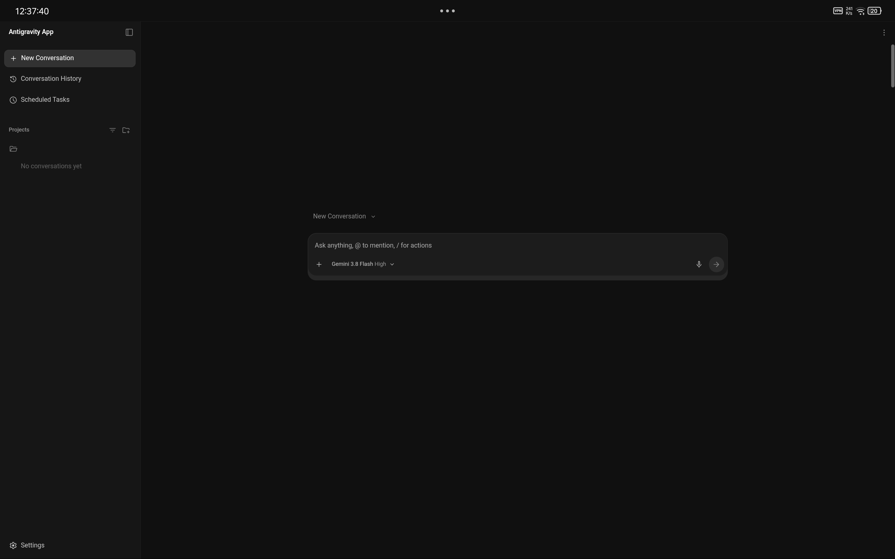
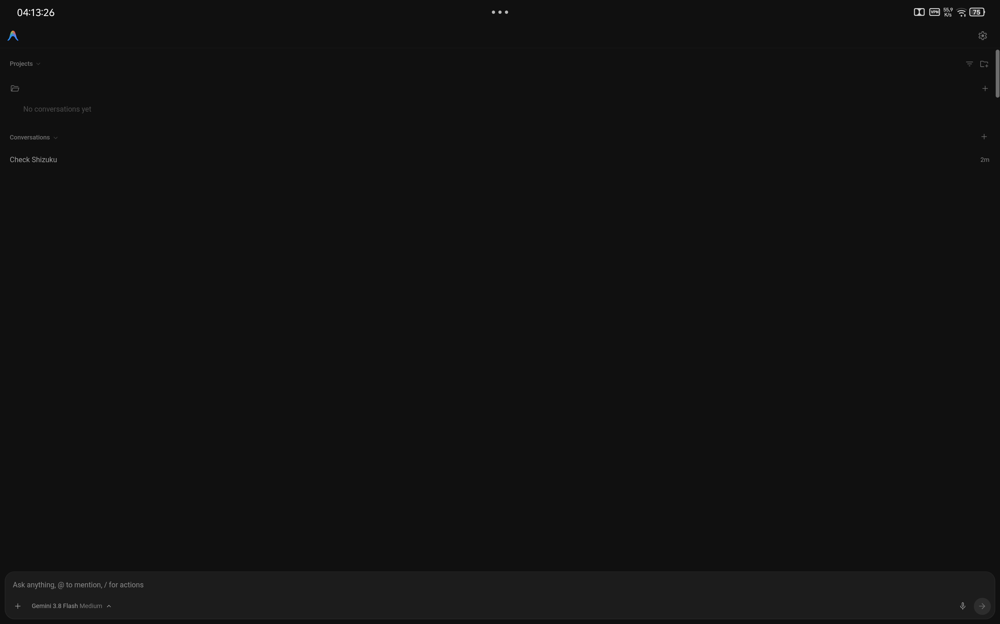
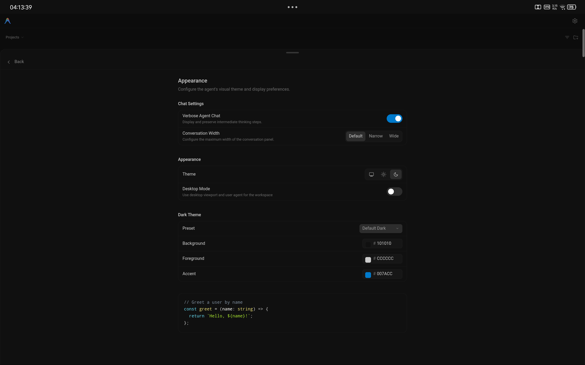
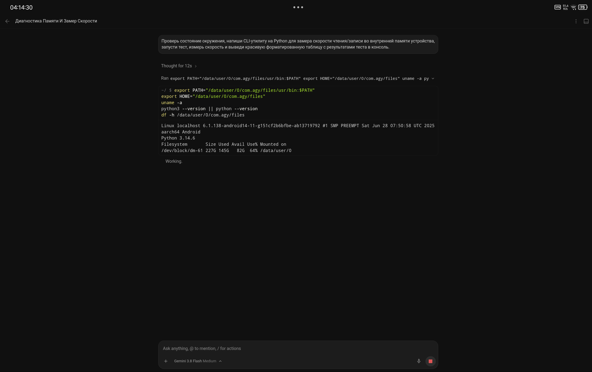
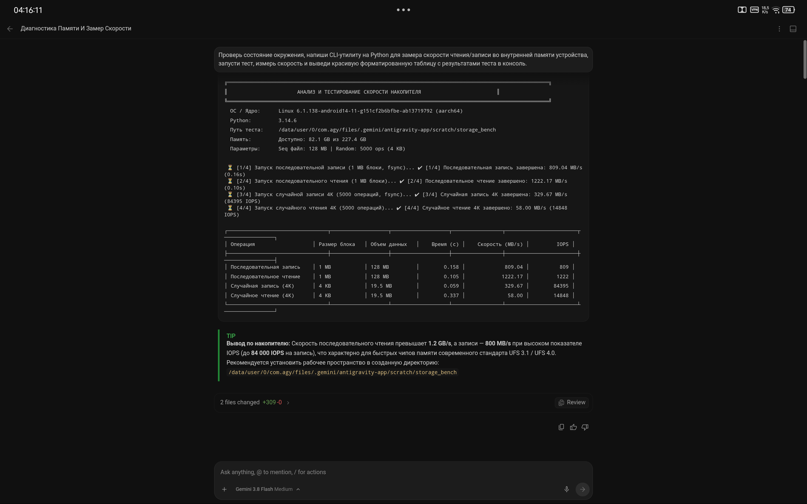

<div align="center">

  <p>
    <b>English</b> &nbsp;&bull;&nbsp; <a href="README.ru.md">Русский</a>
  </p>

  <br/>

  

  # Antigravity for Android

  **Autonomous AI Development Environment & Native Bionic Userspace for Android ARM64**

  [](https://android.com)
  [](https://arm.com)
  [](https://github.com/werdio325-png/antigravity-android/releases)
  [](LICENSE)

  <br/>

  <picture>
    <source media="(prefers-color-scheme: dark)" srcset="docs/assets/hero_dark.png">
    <source media="(prefers-color-scheme: light)" srcset="docs/assets/hero_light.png">
    
  </picture>

</div>

---

> [!IMPORTANT]
> **Independent Community Project Disclaimer:**  
> Antigravity for Android is an independently maintained project led by **Pratik Mengal**. It is **not** an official Google product and is not affiliated with, sponsored by, or endorsed by Google LLC. "Google", "Antigravity", "Android", and related trademarks belong to their respective owners.

---

## 1. Project Introduction

**Antigravity for Android** brings autonomous agentic software development directly to mobile and portable ARM64 devices. 

Unlike conventional approaches that rely on heavy virtualization, chroot containers, or slow PRoot translation, Antigravity executes **bare-metal inside native Android userspace (Bionic)**. This unleashes the full read/write throughput of physical UFS storage and hardware CPU cores. Driven by Gemini AI models, the agent plans software tasks, edits code across multiple project files, executes shell tools, and fixes build issues directly on-device.

---

## 2. Screenshots & Interface

<div align="center">
  <table>
    <tr>
      <td align="center" width="50%">
        <b>Workspace & Chat Interface</b><br/><br/>
        
      </td>
      <td align="center" width="50%">
        <b>Desktop Mode on Tablets / DeX</b><br/><br/>
        
      </td>
    </tr>
    <tr>
      <td align="center" width="50%">
        <b>Autonomous Execution & Tools</b><br/><br/>
        
      </td>
      <td align="center" width="50%">
        <b>Benchmark & Diagnostics Overlay</b><br/><br/>
        
      </td>
    </tr>
  </table>
</div>

---

## 3. Feature Overview

- **Autonomous Agentic Coding:** Plans development tasks, edits multiple files across project trees, runs terminal commands, and resolves compiler errors automatically.
- **Native Bionic Userspace:** Operates directly on Android ARM64 without container or emulation overhead.
- **Built-in Package Manager (`pkg`):** Install full developer runtimes (`python3`, `git`, `nodejs`, `clang`, `bash`) directly from curated Android repositories.
- **Elevated Control (Root & Shizuku):**
  - **Native Root (`su`):** Out-of-the-box support for KernelSU, Magisk, and APatch for privileged device operations.
  - **Shizuku Bridge (`rish`):** Dispatches ADB-level system shell operations (`uid=2000`) on non-rooted devices.
- **Adaptive Viewports & Desktop Mode:** Touch-first interface for phones, with an instant multi-column layout toggle for tablets, foldables, and Samsung DeX.
- **Background Micro-Daemon (`agy-daemon`):** Runs autonomous background tasks, file-change watchers, cron schedules, and notification alerts under Android Foreground Service Partial WakeLock.
- **Hardware Flashlight Bridge (`torch`):** Integrated hardware LED control utility for diagnostic indicators.
- **In-Place Seamless Upgrades:** Built with a consistent signing keystore, allowing upgrades across releases without losing workspace data or configuration.

---

## 4. Architecture Overview

```text
[ Chromium WebView (React Frontend) ]
                ▲
                │  Local Loopback HTTPS (127.0.0.1:45157)
                ▼
[ Language Server Core (Go ELF + glibc loader + liblse_compat.so) ]
       ▲                                          ▲
       │ System Gateway (127.0.0.1:45160)         │ Native PTY Terminal
       ▼                                          ▼
[ Android System Gateway (app/) ]         [ Native Bionic Userspace (env/) ]
  - Status Notifications                   - Bash 5.3, Python 3, Git, Node.js
  - Clipboard, Battery, Toast              - pkg package manager
  - Shizuku & Root execution               - agy-daemon background tasks
```

For a comprehensive technical breakdown of component interactions, see [ARCHITECTURE.md](ARCHITECTURE.md).

---

## 5. Technology Stack

- **Android Host Shell:** Java 17, Android Support / Bionic libc, Target SDK 28, Min SDK 24.
- **Agent Core Engine:** Google Antigravity / JetSki Go ELF binary (`language_server`), Glibc 2.38 AArch64 dynamic loader.
- **Frontend Layer:** Chromium Android WebView, React SPA, Tailwind CSS, PrismJS, PDF.js.
- **Userspace & CLI:** Bionic Userspace, GNU Coreutils, Bash 5.3, Python 3.11, AWK.
- **Hardware Emulation:** `liblse_compat.so` (transparent C library emulating ARMv8.1-A Large System Extensions atomics on ARMv8.0-A CPUs).
- **Build System:** Self-contained Gradle-free builder (`modules/builder/` using Python 3, `aapt`, `javac`, D8, and `apksigner`).

---

## 6. Installation Instructions

### System Requirements
- **Device:** Android ARM64 (`aarch64`) smartphone, tablet, or handheld.
- **Android Version:** Android 7.0 (API 24) or higher.
- **Storage:** Minimum 500 MB free space for the base environment; 2 GB+ recommended for user development toolchains (`python`, `node`, `git`).
- **RAM:** 3 GB minimum; 4 GB+ recommended.

---

## 7. APK Installation Instructions

1. Download the latest release package from [GitHub Releases](https://github.com/werdio325-png/antigravity-android/releases):
   - **`antigravity.apk`** &mdash; Standard production release (recommended).
   - **`antigravity-region-bypass.apk`** &mdash; Production release with account eligibility gate bypass.
2. Install the APK on your device.
3. Open **Antigravity**. Upon first launch, grant **All Files Access** (`MANAGE_EXTERNAL_STORAGE`) so the agent can access your project folders.
4. *(Optional)* If using Shizuku for elevated operations, grant Shizuku permission when prompted.
5. Open the terminal and install standard development packages:
   ```bash
   pkg update
   pkg install git python nodejs
   ```

---

## 8. Build from Source Instructions

Antigravity uses a lightweight, Gradle-free build pipeline that can be executed on any standard Linux environment or directly on an Android device:

```bash
# Clone the repository
git clone https://github.com/werdio325-png/antigravity-android.git
cd antigravity-android

# Build the standard production APK (outputs dist/antigravity.apk):
bash build.sh

# Build the region bypass production APK:
bash build.sh --region-bypass

# Run all 6 modular test suites:
bash test_all_modules.sh
```

For complete step-by-step instructions, dependency setup, and CI configurations, see [BUILD_GUIDE.md](BUILD_GUIDE.md).

---

## 9. Permissions Explanation

| Permission | Technical Requirement & Justification |
| :--- | :--- |
| `INTERNET` | Loopback communication with internal core servers (127.0.0.1) and outbound HTTPS to Gemini / Google Cloud APIs. |
| `ACCESS_NETWORK_STATE` | Monitors active Wi-Fi and mobile connectivity for resilient API polling. |
| `MANAGE_EXTERNAL_STORAGE` | Full read/write access to project workspaces in `/storage/emulated/0/Projects/` on Android 11+. |
| `READ_EXTERNAL_STORAGE` | File access on Android 7.0 &ndash; 9.0 devices. |
| `WRITE_EXTERNAL_STORAGE` | Writing generated code and assets on Android 7.0 &ndash; 9.0 devices. |
| `FOREGROUND_SERVICE` | Runs the core server process continuously in the background without OS freezing. |
| `WAKE_LOCK` | Holds partial CPU wake lock during long compilation or autonomous coding tasks. |
| `POST_NOTIFICATIONS` | Displays status notifications and task completion alerts on Android 13+. |
| `REQUEST_IGNORE_BATTERY_OPTIMIZATIONS` | Requests battery whitelist to prevent aggressive vendor background termination. |
| `CAMERA` | Controls the hardware flashlight (torch) LED via CameraManager. No camera frames are accessed. |
| `INTERNAL_BROADCAST` | Signature-protected permission securing internal application events from external apps. |

---

## 10. Security and Privacy Information

- **Target SDK 28 & W^X Enforcement:** Android 10+ (API 29+) forbids executing dynamically unpacked binaries from app-private storage (`/data/user/0/<pkg>/files`). Targeting API 28 allows the app to execute its runtime natively while maintaining strict internal file permission isolation (`0700`).
- **Loopback Binding (127.0.0.1):** All internal services (`language_server` on port `45157`, `SystemGatewayServer` on port `45160`) bind strictly to localhost. External network interfaces reject all incoming connections.
- **CSRF Protection:** All local HTTP/gRPC requests are validated against a dynamic runtime CSRF token.
- **Production Hardening:** Production release builds strictly omit `android:debuggable="true"`, preventing unauthorized `run-as` access to session tokens.
- **Sensitive Data Redaction:** All logs exported or rendered through the UI pass through automated redaction filters (`LogRedactor.java`, `SensitiveDataRedactor.java`) that scrub OAuth tokens, API keys, and authorization headers.

For detailed security disclosures, see [SECURITY.md](SECURITY.md).

---

## 11. Known Limitations

- **Google Play Store Policy:** Because the application targets API 28 to support direct native binary execution from app storage, it is distributed independently via GitHub Releases and cannot be published to the Google Play Store under current Play target API requirements.
- **Shared Storage `noexec`:** Android mounts `/storage/emulated/0` with the `noexec` mount flag. Shell scripts stored on external storage cannot be executed directly via `./script.sh` and must be invoked with their explicit interpreter (`bash script.sh`, `python script.py`).
- **ARM64 Only:** Only 64-bit ARM (`aarch64`) architecture is supported. 32-bit ARM (`armeabi-v7a`) and x86 devices are not supported.

---

## 12. Contribution Instructions

Contributions, bug reports, and pull requests are welcome!
- Check existing issues before opening a new bug report.
- Ensure all test suites pass by running `bash test_all_modules.sh` prior to submitting pull requests.
- For guidelines on commit formatting, code standards, and branch policies, see [CONTRIBUTING.md](CONTRIBUTING.md).

---

## 13. License Information

This project is licensed under the [Apache License 2.0](LICENSE).  
Copyright &copy; 2026 Pratik Mengal and project contributors.

*(Notice: Portions of the bundled runtime assets, including third-party libraries and upstream tools, are subject to their respective open-source licenses as documented in the repository.)*
