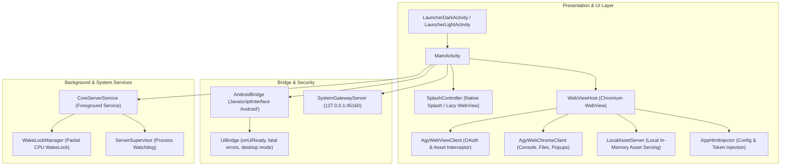

# Android Host Application Shell (`app/`)

> Native Android host shell for Antigravity on ARM64 devices (targetSdk 28 / minSdk 24). Provides the native process supervisor, sandboxed Chromium WebView container, System Gateway HTTP loopback bridge, and elevated Android platform integrations.

---

## 1. Architectural Overview

The `app/` subsystem manages the native Android application lifecycle, launching the core server engine, supervising background operations, and bridging web frontend events to hardware subsystems:

---

## 2. Subsystem Components

### 2.1 UI Presentation Layer
- **`MainActivity.java`**: Primary Activity handling window insets, configuration changes, edge-to-edge drawing, and fullscreen flags.
- **`SplashController.java`**: Renders smooth native launch dots and coordinates transitions between native splash and WebView readiness.
- **`WebViewHost.java`**: Configures hardened Chromium WebView settings (disables insecure file schemes, enables hardware acceleration and DOM storage).
- **`LocalAssetServer.java`**: Serves local frontend assets over loopback without exposing unencrypted cleartext `file://` URIs.

### 2.2 Bridge & Security Layer
- **`AndroidBridge.java`**: `@JavascriptInterface` bridge exposing core native hooks (`getAppVersion`, `isDesktopMode`, `notifyUiReady`, `requestExit`).
- **`SystemGatewayServer.java`**: Lightweight internal HTTP server on `127.0.0.1:45160` handling system actions (status bar notifications, clipboard, flashlight torch, device telemetry).

### 2.3 Service & Supervisor Layer
- **`CoreServerService.java`**: Runs as an Android Foreground Service with continuous notification status, preventing OEM OS background termination.
- **`WakeLockManager.java`**: Acquires partial CPU wake locks during intense autonomous coding or compilation workflows.
- **`PrivilegedShellBridge.java`**: Direct interfaces for elevated execution:
  - **Shizuku / `rish`**: ADB shell operations (`uid=2000`) on non-rooted devices.
  - **Native Root (`su`)**: Direct root operations (`uid=0`) with auto-detection for KernelSU, Magisk, and APatch.

---

## 3. Security Hardening

- **Loopback Enforcement:** Internal servers bind strictly to `127.0.0.1`. Incoming connections from external Wi-Fi or mobile network interfaces are rejected immediately.
- **Dynamic CSRF Tokens:** Every local HTTP request between the web layer and gateway validates dynamic runtime session tokens.
- **Redaction Engine:** All exported Android logcat and file logs pass through automated filters scrubbing API keys and OAuth tokens.
