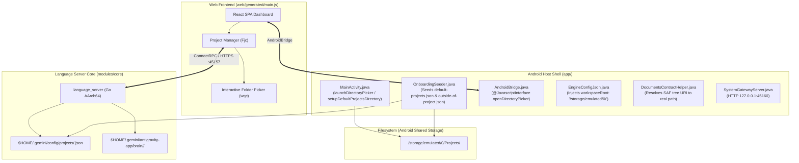
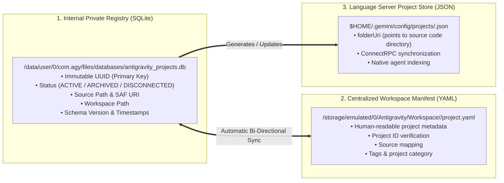
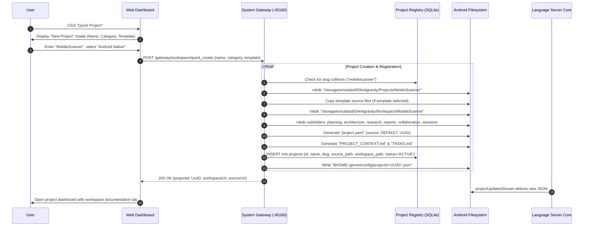
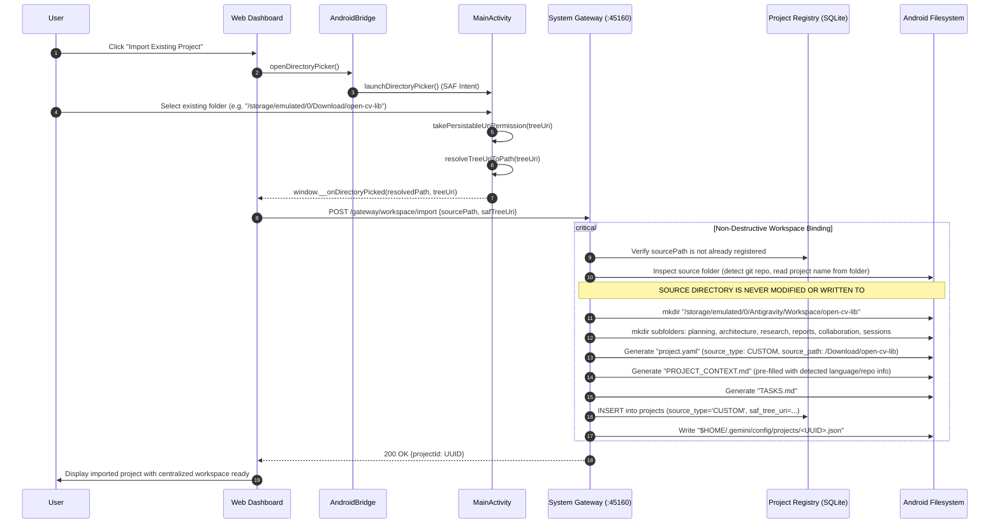
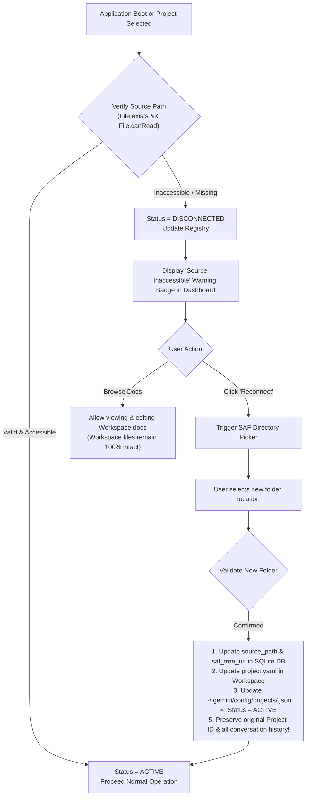
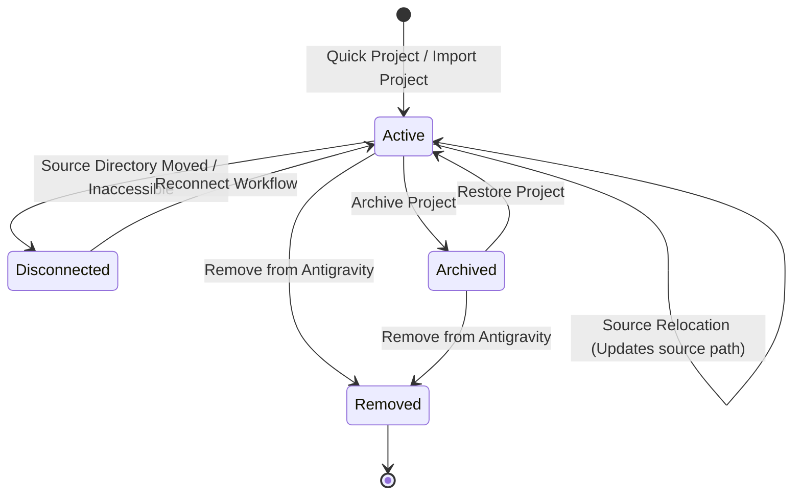
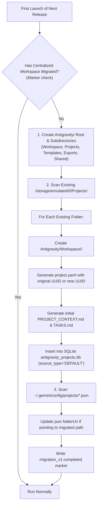

# Centralized Workspace Architecture & Implementation Plan: Antigravity Android

> **Technical Planning & Implementation Specification for Next Release**  
> *Target Architecture:* Architecture A (Centralized Workspace)  
> *Target Environment:* Native Android (ARM64 / `aarch64`, Android 7.0–15+, API 24–35, TargetSdk 28)  
> *Author:* Antigravity Engineering Team  
> *Status:* Ready for Review &mdash; Baseline Planning Specification

---

## 1. Executive Summary

This specification establishes a professional, centralized workspace management system as the default organizational structure for **Antigravity Android**.

Currently, project source code, agent scratchpads, conversation transcripts, and workspace definitions are fragmented across `/storage/emulated/0/Projects/`, private application data directories (`$HOME/.gemini/config/projects/*.json`), and ad-hoc brain directories (`$HOME/.gemini/antigravity-app/brain/<convo-id>/`). This setup lacks a uniform documentation standard, human-readable metadata, decoupled workspace-to-source mappings, and resilient project reconnection mechanisms when directories relocate.

The finalized **Architecture A (Centralized Workspace)** decouples the project's intellectual development lifecycle (planning, architecture, ADRs, research, reports, agent collaboration records) from the concrete source repository:
- **Centralized Documentation Root:** Stored under `Internal Storage/Antigravity/Workspace/<ProjectName>/`.
- **Decoupled Source Code:** Stored by default under `Internal Storage/Antigravity/Projects/<ProjectName>/` or anywhere in user-accessible storage (Downloads, Documents, external SD cards, Git clones).
- **Unified Identity & Registration:** Powered by an immutable UUID-backed SQLite registry database in private app storage, mirrored by a human-readable `project.yaml` in the centralized workspace, and seamlessly synchronized with the language server's native project store (`~/.gemini/config/projects/`).
- **Complete Non-Destructive Invariance:** Source directories are never modified or polluted during project registration, and project removals from Antigravity strictly preserve source code.

---

## 2. Current Architecture Assessment

An exhaustive inspection of the existing codebase reveals how Antigravity manages files, storage, and projects today:



### Current Architectural State:
1. **Directory Initialization & Permissions:**
   - In `MainActivity.java` (lines 398–415), `setupDefaultProjectsDirectory()` creates `/storage/emulated/0/Projects` if storage permission is present.
   - In `OnboardingSeeder.java` (lines 165–220), a default project stub (`default-projects.json`) is written to `$HOME/.gemini/config/projects/` pointing to `file:///storage/emulated/0/Projects` and `file:///storage/emulated/0`. It also creates `/storage/emulated/0/Projects`.
2. **Directory Selection & SAF:**
   - `MainActivity.launchDirectoryPicker()` (lines 486–503) fires `Intent.ACTION_OPEN_DOCUMENT_TREE` with persistable read permissions.
   - `DocumentsContractHelper.java` (lines 22–55) resolves the SAF `treeUri` (`primary:path`) into an absolute POSIX path.
   - `AndroidBridge.openDirectoryPicker()` (lines 61–71) exposes this to JavaScript, but the web UI currently defaults to an in-WebView custom folder browser (`wqc` in `main.js`).
3. **Project Management & Storage:**
   - The Go language server core (`language_server`) maintains project definitions in `$HOME/.gemini/config/projects/<id>.json`.
   - The web frontend communicates with the core via ConnectRPC (`createProject`, `updateProject`, `deleteProject`, `readProjects`, `projectUpdatesStream`).
   - Project documentation is not centralized; agents write artifacts and logs to conversation-scoped paths in `$HOME/.gemini/antigravity-app/brain/<conversation-id>/`, which are invisible and inaccessible to users in standard Android file managers.
4. **Target SDK & Scoped Storage Context:**
   - `AndroidManifest.xml` specifies `targetSdkVersion="28"`. This is intentionally chosen to allow binary execution (`W^X` policy bypass) from the app's private files directory.
   - Manifest declares `READ_EXTERNAL_STORAGE`, `WRITE_EXTERNAL_STORAGE`, `MANAGE_EXTERNAL_STORAGE`, and `requestLegacyExternalStorage="true"`.

---

## 3. Existing Functionality That Can Be Reused

The existing codebase contains solid building blocks that will be directly leveraged:

1. **SAF Resolution & Persistable Permissions:**
   - `DocumentsContractHelper.resolveTreeUriToPath()` accurately extracts physical paths from `primary:` and secondary storage volume document IDs.
   - `MainActivity.onActivityResult()` already executes `takePersistableUriPermission()`.
2. **JavaScript Bridge Directory Picker:**
   - `AndroidBridge.openDirectoryPicker()` and callback `window.__onDirectoryPicked` provide native directory picking.
3. **Embedded HTTP System Gateway (`127.0.0.1:45160`):**
   - `SystemGatewayServer.java` and `GatewayDispatcher.java` provide an extensible, zero-dependency REST/JSON interface between native Android userspace, daemons, and web clients.
4. **Idempotent Bootstrapping & Seeding:**
   - `OnboardingSeeder.java` executes reliably before the core language server starts up. It handles atomic file writes, directory setups, and pre-seeding without overwriting existing user data.
5. **Atomic File Utilities & Redaction:**
   - `AtomicFileWriter.java` provides crash-safe, atomic file writes via staging files and rename semantics.
   - `PathSafety.java` offers canonical directory path validation against directory traversal (`../`).
6. **Frontend Web Patcher:**
   - `web/patch_main.py` allows clean build-time modifications to `main.js` without recompilation of upstream components.

---

## 4. Gaps Between Current Implementation & Proposed Architecture

| Feature Area | Current Implementation | Proposed Centralized Architecture | Gap Severity |
| :--- | :--- | :--- | :--- |
| **Default Root Path** | `/storage/emulated/0/Projects/` | `/storage/emulated/0/Antigravity/` | High |
| **Workspace Decoupling** | No concept of a detached `Workspace/` directory; docs mix with code or get lost in `brain/` | All planning, architecture, research, reports, and AI notes live in `Antigravity/Workspace/<Project>/` | Critical |
| **Project Identity & Registry** | Stored only in private JSON files (`~/.gemini/config/projects/<id>.json`); paths and IDs loosely coupled | SQLite database (`projects.db`) tracking UUID, paths, status, timestamps, and schema version | Critical |
| **Human-Readable Manifest** | None; internal protobuf/JSON format only | Standardized `project.yaml` in each workspace root | High |
| **Workflow Separation** | Unified "New Project" and random "Quick Start" creating scratch folders | Explicit Quick Project, Import Existing, and Reconnect workflows | High |
| **Reconnection Architecture** | Missing; moving a folder breaks project indexing | Detects inaccessible paths, marks `DISCONNECTED`, allows re-binding while retaining workspace and UUID | Critical |
| **Lifecycle Safety** | Removing a project deletes the `.json` file; no safety guarantees or workspace cleanup | Explicit deletion safety: Source code is NEVER deleted when removing from Antigravity | Critical |
| **Template Engine** | None | Pre-seeded templates in `Antigravity/Templates/` for projects, docs, and architecture | Medium |
| **Workspace Schema Versioning** | Unversioned flat files | Versioned schema (`schema_version: 1`) with automated, non-destructive migration runner | High |

---

## 5. Final Recommended Folder Hierarchy

### 5.1. Logical & Physical Organization

All user-visible Antigravity data will reside under `Internal Storage/Antigravity/` (resolved dynamically as `Environment.getExternalStorageDirectory() + "/Antigravity"`):

```
/storage/emulated/0/Antigravity/
│
├── Workspace/                             # Centralized project documentation & intelligence
│   ├── <ProjectName>/
│   │   ├── project.yaml                   # Human-readable project manifest & sync binding
│   │   ├── PROJECT_CONTEXT.md             # Core identity, vision, tech stack, constraints
│   │   ├── TASKS.md                       # Active backlog, sprint items, completed milestones
│   │   ├── PROJECT_REQUIREMENTS.md        # (Progressive) Functional & non-functional requirements
│   │   ├── ROADMAP.md                     # (Progressive) Milestones, deliverables, release schedule
│   │   ├── DECISIONS.md                   # (Progressive) Architecture Decision Records (ADRs)
│   │   ├── CHANGELOG.md                   # (Progressive) Version history and release notes
│   │   │
│   │   ├── planning/                      # Sprint plans, feature specs, implementation outlines
│   │   ├── architecture/                  # HLD, LLD, system diagrams, DB schemas, API specs
│   │   ├── research/                      # Benchmarks, spikes, tech evaluations, library comparisons
│   │   ├── reports/                       # Security audits, test runs, linting, performance profiling
│   │   ├── collaboration/                 # Agent system prompts, handoff notes, multi-agent protocols
│   │   └── sessions/                      # Session context, chronological summaries, next steps
│   │
│   └── AnotherProject/
│
├── Projects/                              # Default location for newly created source code repositories
│   ├── <ProjectName>/                     # Pristine source code (git repo, code files, no workspace clutter)
│   └── AnotherProject/
│
├── Templates/                             # Reusable blueprints for rapid bootstrapping
│   ├── project-templates/
│   │   ├── android-native/                # Native Android (Java/Kotlin, Gradle-free/Bionic)
│   │   ├── web-react-vite/                # React + Tailwind + Vite template
│   │   ├── backend-fastapi/               # Python 3 + FastAPI microservice
│   │   ├── backend-express/               # Node.js + Express API
│   │   └── research-study/                # Markdown & data science experiment template
│   ├── documentation-templates/
│   │   ├── adr-template.md                # Architecture Decision Record template
│   │   ├── requirement-spec.md            # Detailed feature requirement specification
│   │   ├── security-audit.md              # Penetration testing & audit report template
│   │   └── session-summary.md             # End-of-session handoff template
│   └── architecture-templates/
│       ├── c4-model-architecture.md       # C4 diagram templates using Mermaid
│       └── er-database-schema.md          # Entity-Relationship diagram templates
│
├── Exports/                               # User export destination
│   ├── reports/                           # PDF / Markdown exported reports
│   ├── documentation-packages/            # Packaged workspace zip bundles
│   └── backups/                           # Snapshot backups of Workspace metadata & DB
│
└── Shared/                                # Global assets shared across all projects
    ├── references/                        # Cheatsheets, API docs, offline developer guides
    ├── resources/                         # Common icons, SVG assets, base configs
    └── common-guidelines/                 # Global coding conventions, agent guidelines
```

---

## 6. Project Registration & Identity Architecture

### 6.1. Tri-Layer Registration System

To guarantee stability, human-readability, and complete interoperability with existing components, project identity is managed across three synchronized layers:



### 6.2. `project.yaml` Specification

Every project workspace contains a root `project.yaml` providing a clear, human-readable description of the project and its bindings:

```yaml
schema_version: 1
id: "7f4c9b20-8e1a-4d2b-9832-11c5e4a809f1"
name: "Antigravity Android"
slug: "antigravity-android"
description: "Native Android IDE and agentic coding assistant"
category: "ANDROID"
status: "ACTIVE"

paths:
  source:
    type: "DEFAULT" # "DEFAULT" or "CUSTOM"
    uri: "file:///storage/emulated/0/Antigravity/Projects/antigravity-android"
    resolved_path: "/storage/emulated/0/Antigravity/Projects/antigravity-android"
  workspace:
    resolved_path: "/storage/emulated/0/Antigravity/Workspace/antigravity-android"

vcs:
  type: "git"
  default_branch: "main"

timestamps:
  created_at: 1731234000000
  updated_at: 1731234000000
  last_accessed_at: 1731234000000

settings:
  auto_session_summaries: true
  export_on_archive: true
```

---

## 7. Database Schema Proposal

The internal project registry will be implemented using Android's native `android.database.sqlite.SQLiteOpenHelper` in private app storage: `/data/user/0/com.agy/files/databases/antigravity_projects.db`.

### 7.1. DDL Specification

```sql
-- Database: antigravity_projects.db
-- Schema Version: 1

PRAGMA foreign_keys = ON;

CREATE TABLE IF NOT EXISTS projects (
    id TEXT PRIMARY KEY NOT NULL,                   -- Immutable UUID v4
    name TEXT NOT NULL,                             -- Human-readable project name
    slug TEXT NOT NULL UNIQUE,                      -- Directory name in Antigravity/Workspace/
    description TEXT,                               -- Brief project overview
    project_type TEXT NOT NULL DEFAULT 'GENERIC',   -- ANDROID, WEB, BACKEND, FULLSTACK, LIBRARY, RESEARCH, GENERIC
    status TEXT NOT NULL DEFAULT 'ACTIVE',          -- ACTIVE, ARCHIVED, DISCONNECTED
    source_type TEXT NOT NULL DEFAULT 'DEFAULT',    -- DEFAULT (under Antigravity/Projects) or CUSTOM
    source_uri TEXT NOT NULL,                       -- file:///... or content://...
    source_path TEXT NOT NULL,                      -- Resolved absolute filesystem path
    workspace_path TEXT NOT NULL,                   -- Absolute path to centralized workspace directory
    saf_tree_uri TEXT,                              -- Persisted SAF Tree Uri string (for custom locations)
    schema_version INTEGER NOT NULL DEFAULT 1,      -- Workspace directory schema version
    vcs_type TEXT DEFAULT 'none',                   -- git, jj, none
    default_branch TEXT,                            -- e.g. main, master
    metadata_json TEXT,                             -- Extensible JSON for custom user tags / agent flags
    created_at INTEGER NOT NULL,                    -- Epoch timestamp (milliseconds)
    updated_at INTEGER NOT NULL,                    -- Epoch timestamp (milliseconds)
    last_accessed_at INTEGER NOT NULL               -- Epoch timestamp (milliseconds)
);

CREATE INDEX IF NOT EXISTS idx_projects_status ON projects(status);
CREATE INDEX IF NOT EXISTS idx_projects_slug ON projects(slug);
CREATE INDEX IF NOT EXISTS idx_projects_source_path ON projects(source_path);

CREATE TABLE IF NOT EXISTS workspace_documents (
    id INTEGER PRIMARY KEY AUTOINCREMENT,
    project_id TEXT NOT NULL,
    category TEXT NOT NULL,                         -- ROOT, PLANNING, ARCHITECTURE, RESEARCH, REPORTS, COLLABORATION, SESSIONS
    file_name TEXT NOT NULL,                        -- e.g. PROJECT_CONTEXT.md
    relative_path TEXT NOT NULL,                    -- e.g. architecture/hld.md
    file_size INTEGER DEFAULT 0,
    created_at INTEGER NOT NULL,
    updated_at INTEGER NOT NULL,
    FOREIGN KEY(project_id) REFERENCES projects(id) ON DELETE CASCADE
);

CREATE INDEX IF NOT EXISTS idx_docs_project_id ON workspace_documents(project_id);

CREATE TABLE IF NOT EXISTS schema_migrations (
    version INTEGER PRIMARY KEY NOT NULL,
    applied_at INTEGER NOT NULL,
    description TEXT NOT NULL
);

INSERT OR IGNORE INTO schema_migrations (version, applied_at, description)
VALUES (1, strftime('%s','now') * 1000, 'Initial centralized workspace schema');
```

---

## 8. Android Storage & Permission Strategy

### 8.1. Storage Constraints & Platform Realities

| Storage Dimension | Behavioral Rule & Implementation Detail |
| :--- | :--- |
| **Target SDK 28 Context** | `targetSdkVersion="28"` allows the app to `exec()` compiled AArch64 binaries (`language_server`, `bash`, `python`) from `$HOME/runtime/bin` without triggering Android 10+ `W^X` SELinux denials. |
| **Scoped Storage on API 30+** | Despite `targetSdkVersion="28"`, Android 11+ (API 30+) kernel FUSE enforcement restricts raw POSIX `open()`/`mkdir()` on top-level shared storage unless `MANAGE_EXTERNAL_STORAGE` is granted or root/Shizuku privileges are used. |
| **`MANAGE_EXTERNAL_STORAGE` Justification** | Antigravity is a standalone IDE and autonomous coding engine. Compilers (`clang`), interpreters (`python`, `node`), build tools (`aapt`, `javac`, `d8`), and version control (`git`) operate strictly via POSIX syscalls on source files. They cannot interface with Android SAF `ContentProvider` streams. Therefore, `MANAGE_EXTERNAL_STORAGE` is an absolute requirement for developer workflows on shared storage. |
| **Physical Path Resolution** | Primary: `/storage/emulated/0/Antigravity/`.<br/>Graceful Scoped Fallback: If `MANAGE_EXTERNAL_STORAGE` is withheld by the user, the app falls back to `/storage/emulated/0/Android/data/com.agy/files/Antigravity/` (app-specific external storage, no permissions required), while notifying the user of the reduced visibility. |
| **Permissions Hierarchy** | 1. **Auto-Grant (Root/Shizuku):** If rooted or Shizuku is running, `MainActivity` automatically runs `appops set com.agy MANAGE_EXTERNAL_STORAGE allow`.<br/>2. **User Dialog:** On stock unrooted Android 11+, display an educational onboarding modal and dispatch `ACTION_MANAGE_APP_ALL_FILES_ACCESS_PERMISSION`.<br/>3. **Legacy (Android 7–10):** Standard runtime prompt for `READ_EXTERNAL_STORAGE` and `WRITE_EXTERNAL_STORAGE`. |
| **Data Partitioning** | **Public & User-Accessible:** `Antigravity/` (Workspace, Projects, Templates, Exports, Shared).<br/>**Private & Protected:** `$HOME/` (`/data/user/0/com.agy/files/`): runtime binaries, glibc, SQLite registry, OAuth tokens, keystores. |

---

## 9. Quick Project Workflow



### Initial Documents Generated:
- `project.yaml`: Full metadata and bindings.
- `PROJECT_CONTEXT.md`: Seeded with project name, timestamp, and standard context sections.
- `TASKS.md`: Initialized with onboarding checklist and sprint backlog.
- Subdirectories (`planning/`, `architecture/`, etc.): Created empty, ready for on-demand file creation (no empty placeholder markdown files).

---

## 10. Existing Project Import Workflow



---

## 11. Reconnection & Recovery Workflow

When projects are stored on removable SD cards, USB drives, or customized paths that get relocated or permissions revoked, the reconnection workflow restores access without data loss:



---

## 12. Workspace Lifecycle Management



### Lifecycle Operations & Safety Guardrails:

1. **Project Renaming:**
   - Updates `name` in SQLite database, `project.yaml`, and `$HOME/.gemini/config/projects/<UUID>.json`.
   - Workspace folder in `Antigravity/Workspace/` can be renamed atomically.
   - The actual source folder name is **not renamed** unless explicitly selected, avoiding broken build scripts or external Git remote tracking.
2. **Project Archiving:**
   - Marks `status = 'ARCHIVED'` in SQLite and updates `project.yaml`.
   - Marks `archived: true` in `$HOME/.gemini/config/projects/<UUID>.json`.
   - Hidden from primary dashboard; accessible under "Archived Projects".
3. **Project Restoration:**
   - Marks `status = 'ACTIVE'` and re-indexes in active dashboard.
4. **Project Removal (CRITICAL DATA-LOSS PREVENTION):**
   - **Rule 1 (Default):** Removing a project removes the entry from `antigravity_projects.db` and deletes the internal `$HOME/.gemini/config/projects/<UUID>.json`.
   - **Rule 2 (Workspace Retention):** The user is asked via a clear checkbox whether to keep or archive the centralized workspace.
   - **Rule 3 (Source Code Protection):** **THE SOURCE REPOSITORY IS NEVER DELETED.** A prominent UI banner states: *"Your source files in `<source_path>` will remain completely untouched on your device."*
5. **Documentation Export & Backup:**
   - **Export Documentation Package:** Bundles `Antigravity/Workspace/<ProjectName>/` into a zip archive stored in `Antigravity/Exports/documentation-packages/<ProjectName>_docs_YYYYMMDD.zip`.
   - **Workspace Snapshot Backup:** Creates an encrypted or plain zip snapshot of the SQLite database and all centralized workspaces into `Antigravity/Exports/backups/`.

---

## 13. Template Management Design

Templates reside in `/storage/emulated/0/Antigravity/Templates/` and are seeded during initial installation:

### 13.1. Template Categories & Contents

1. **Project Templates (`Templates/project-templates/`):**
   - `android-native/`: Minimal Android manifest, Bionic build script (`build.sh`), sample `MainActivity.java`.
   - `web-react-vite/`: Modern `package.json`, `vite.config.js`, `src/App.jsx`, `tailwind.config.js`.
   - `backend-fastapi/`: `main.py`, `requirements.txt`, `Dockerfile`, healthcheck routes.
   - `backend-express/`: `server.js`, `package.json`, REST router boilerplate.
   - `research-study/`: Structured markdown templates for benchmark testing and exploratory coding.
2. **Documentation Blueprints (`Templates/documentation-templates/`):**
   - `adr-template.md`: Context, Decision Drivers, Considered Options, Pros & Cons, Decision Outcome.
   - `requirement-spec.md`: User Stories, Acceptance Criteria, Edge Cases, Security Considerations.
   - `session-summary.md`: Accomplishments, Decisions Made, Blockers, Next Steps.
3. **Architecture Diagrams (`Templates/architecture-templates/`):**
   - `c4-model-architecture.md`: Context, Container, Component, and Code diagrams with Mermaid syntax.
   - `er-database-schema.md`: Relational and document database schema templates with Mermaid ER diagrams.

---

## 14. Migration & Backward Compatibility Strategy

### 14.1. Seamless In-Place Migration

Existing users have projects in `/storage/emulated/0/Projects/` and configuration files in `$HOME/.gemini/config/projects/`. The migration process runs during the first app boot of the new release via `OnboardingSeeder.java`:



### Safety Guarantees:
- **No File Moves by Force:** Existing code in `/storage/emulated/0/Projects/` is **not** forcefully moved; instead, symbolic links or direct path preservation can be used, or the folder is treated as a default project source directory.
- **Non-Destructive Overwrites:** If a workspace document already exists, the seeder skips it.

---

## 15. UI / Dashboard Changes Required

The React web frontend (`web/` and `web/generated/main.js`) will be updated via `web/patch_main.py` and new React components in `web/src/`:

1. **Top-Level Navigation Bar:**
   - Add a direct workspace switcher toggle between **Source View** and **Workspace Docs View**.
2. **Sidebar Project Dropdown:**
   - Update `R_b` menu options:
     - **Quick Project** (Instantly creates project in `Antigravity/Projects/` + Centralized Workspace).
     - **Import Existing** (Launches native SAF folder picker, links to Centralized Workspace).
     - **Templates Gallery** (Browse and preview built-in blueprints).
3. **Project Settings & Status Badges:**
   - Display project badges: `Active`, `Archived`, or `Disconnected`.
   - For `Disconnected` projects: Display an amber warning with a one-click **"Reconnect Source Folder"** button.
4. **Workspace Document Tree Inspector:**
   - A dedicated documentation sidebar panel allowing direct markdown browsing and editing of the active project's `planning/`, `architecture/`, `research/`, `reports/`, and root docs.

---

## 16. Security & Data-Loss Prevention Considerations

1. **Path Traversal & Injection Prevention:**
   - All directory names (`slug`) are validated against regex `^[a-zA-Z0-9_\-\.]+$` to block path traversal (`../`) attacks using `PathSafety.java`.
2. **Canonical Path Resolution:**
   - File operations always resolve canonical paths (`getCanonicalPath()`) and ensure they fall strictly within `Antigravity/` or an authorized SAF directory.
3. **Atomic Writes:**
   - All updates to `project.yaml`, workspace documents, and SQLite transactions use atomic file writers (`AtomicFileWriter.java`) with `.tmp` staging to prevent corruption during app kill or power loss.
4. **Source Code Immutability Guarantee:**
   - Deletion of an Antigravity project is strictly prohibited from executing recursive deletions on the source code folder. The UI will explicitly confirm removal from the IDE index only.

---

## 17. Proposed Implementation Phases

### Phase 1: Storage Infrastructure & Directory Initializer
- **Affected Modules:** `app/src/main/java/com/agy/workspace/storage/`, `MainActivity.java`, `RuntimePaths.java`
- **Dependencies:** None
- **Tasks:**
  - Create `WorkspaceStorageManager.java` to handle creation and validation of `Internal Storage/Antigravity/` root, `Workspace/`, `Projects/`, `Templates/`, `Exports/`, and `Shared/`.
  - Update `MainActivity.setupDefaultProjectsDirectory()` to initialize the new hierarchy.
- **Verification:** Unit tests confirming all directories are created idempotently on Android filesystem with proper permissions.

### Phase 2: SQLite Project Registry & Gateway API
- **Affected Modules:** `app/src/main/java/com/agy/workspace/db/`, `app/src/main/java/com/agy/gateway/handlers/`, `GatewayDispatcher.java`
- **Dependencies:** Phase 1
- **Tasks:**
  - Implement `ProjectDbHelper.java` and `ProjectRegistryRepository.java`.
  - Add `WorkspaceGatewayHandler.java` exposing endpoints over `127.0.0.1:45160`:
    - `workspace_list`, `workspace_quick_create`, `workspace_import`, `workspace_reconnect`, `workspace_archive`, `workspace_remove`.
- **Verification:** Test SQLite CRUD operations, foreign key cascades, and HTTP gateway JSON responses.

### Phase 3: Centralized Workspace Generator & Manifest Engine
- **Affected Modules:** `app/src/main/java/com/agy/workspace/generator/`, `app/src/main/java/com/agy/workspace/model/`
- **Dependencies:** Phase 1, Phase 2
- **Tasks:**
  - Implement `ProjectYamlParser.java` and `WorkspaceDocumentGenerator.java`.
  - Generate initial `project.yaml`, `PROJECT_CONTEXT.md`, and `TASKS.md` with standard templates.
  - Package initial blueprints into `assets/runtime/templates/` and unpack to `Antigravity/Templates/`.
- **Verification:** Generate workspace for a mock project; verify YAML schema compliance and markdown readability.

### Phase 4: Language Server Integration & Seeder Migration
- **Affected Modules:** `OnboardingSeeder.java`, `EngineConfigJson.java`
- **Dependencies:** Phase 2, Phase 3
- **Tasks:**
  - Update `OnboardingSeeder` to run initial migration: scan existing projects, populate SQLite registry, and maintain synchronized `<UUID>.json` files in `$HOME/.gemini/config/projects/`.
  - Update `EngineConfigJson` to inject the new `workspaceRoot` (`/storage/emulated/0/Antigravity/`).
- **Verification:** Verify that `language_server` boots without warnings and picks up projects through `projectUpdatesStream`.

### Phase 5: Web UI & Dashboard Integration
- **Affected Modules:** `web/patch_main.py`, `web/src/workspace/`, `web/src/core/config.js`
- **Dependencies:** Phase 4
- **Tasks:**
  - Update `web/patch_main.py` to wire `handleStartOsFolderPicker` directly to `AndroidBridge.openDirectoryPicker()`.
  - Add Quick Project and Reconnect dialogs to the frontend.
  - Add Centralized Workspace documentation panel to the dashboard view.
- **Verification:** Execute `bash web/build.sh` and verify live UI interactions in Chromium WebView.

### Phase 6: E2E Verification & Security Hardening
- **Affected Modules:** `test_all_modules.sh`, `modules/runner/test_e2e.sh`
- **Dependencies:** All previous phases
- **Tasks:**
  - Full end-to-end regression test: Project creation -> Documentation generation -> Disconnection simulation -> Reconnection -> Project deletion safety check.
  - APK build verification via `bash build.sh`.
- **Verification:** Clean pass on all modules with zero regression.

---

## 18. Risks, Dependencies & Unresolved Decisions

### Technical Risks & Mitigations:
1. **Risk:** High Android OS versions (Android 13–15) aggressively blocking top-level directory creation if the user declines `MANAGE_EXTERNAL_STORAGE`.
   - *Mitigation:* Implement automatic detection. If top-level `/storage/emulated/0/Antigravity` fails with `EACCES`, fallback automatically to `/storage/emulated/0/Android/data/com.agy/files/Antigravity` and display an explanatory notification.
2. **Risk:** FUSE filesystem latency on `/storage/emulated/0` when scanning deep workspace subdirectories.
   - *Mitigation:* Cache document metadata in SQLite (`workspace_documents` table); do not perform recursive directory walks on UI thread.
3. **Risk:** Desynchronization between `project.yaml` and SQLite database if the user edits `project.yaml` manually in an external editor.
   - *Mitigation:* Implement hash check or file-modification timestamp comparison when opening a project; if `project.yaml` is newer, refresh SQLite registry.

### Unresolved Decisions for Review:
1. **Workspace Folder Renaming Behavior:** When a project is renamed, should the centralized workspace folder name (`Antigravity/Workspace/<slug>`) always rename to match, or remain fixed to prevent breaking external references? *(Recommended: Rename if no open file locks exist, otherwise keep slug and update display name).*
2. **Default Git Initialization in `Projects/<Name>`:** Should Quick Project automatically run `git init` in the newly created source directory by default? *(Recommended: Yes, standard practice for modern IDEs).*

---

## 19. Testing & Acceptance Criteria

### Acceptance Test Matrix:

| Test Case | Scenario / Steps | Expected Result | Pass/Fail Criteria |
| :--- | :--- | :--- | :--- |
| **TC-01: Fresh Install Setup** | Clean app launch on device without pre-existing files | `Internal Storage/Antigravity/` and all 5 subdirectories (`Workspace/`, `Projects/`, `Templates/`, `Exports/`, `Shared/`) created automatically | Directories exist; `antigravity_projects.db` initialized |
| **TC-02: Quick Project Creation** | User enters "DemoApp", selects "Web React Vite", clicks Create | 1. Source created in `Projects/DemoApp`<br/>2. Workspace created in `Workspace/DemoApp`<br/>3. `project.yaml`, `PROJECT_CONTEXT.md`, `TASKS.md` generated<br/>4. Registered in SQLite and language server | Project visible in dashboard; source and workspace separated |
| **TC-03: Existing Project Import** | User imports existing folder from `/storage/emulated/0/Download/sample` | 1. Source files untouched<br/>2. Workspace created in `Workspace/sample`<br/>3. `project.yaml` records `CUSTOM` source type<br/>4. Persistable SAF permission retained | Zero file changes in source folder; workspace correctly bound |
| **TC-04: Reconnection on Missing Source** | Relocate or rename source folder on disk, reopen project | 1. Project shows `DISCONNECTED` badge<br/>2. Workspace docs remain fully viewable<br/>3. User clicks Reconnect, selects new folder<br/>4. Status returns to `ACTIVE` | Project ID preserved; conversation history preserved |
| **TC-05: Non-Destructive Removal** | Remove project from Antigravity via UI | 1. Database entry removed<br/>2. Internal language server JSON removed<br/>3. Source directory in storage remains intact | **Zero source files deleted** |
| **TC-06: Schema Migration** | Launch app with pre-existing legacy `/storage/emulated/0/Projects/` | Legacy projects indexed into SQLite; centralized workspace stubs generated without moving user source files | Smooth migration; no data lost |
