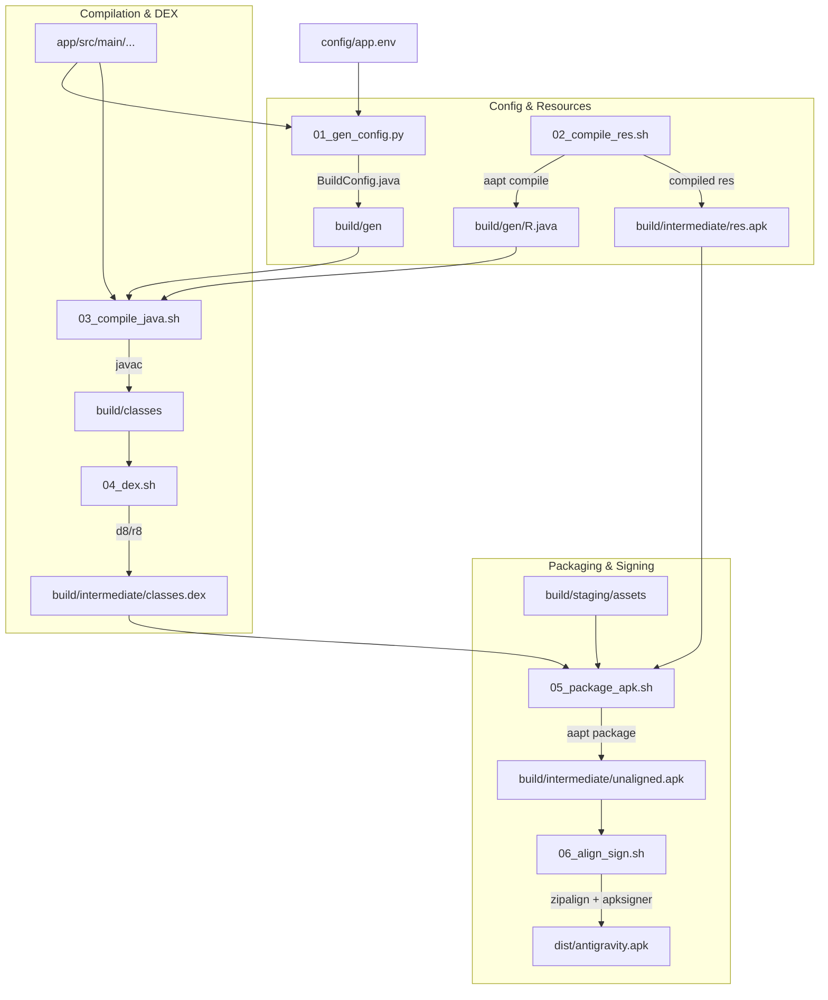

# APK Builder Subsystem (`modules/builder`)

> Standalone, Gradle-free Android APK packaging pipeline.
> Optimized for native on-device execution on ARM64 Android hardware and desktop Linux.

---

## 1. Architectural Overview

Antigravity compiles and packages its Android host APK without relying on Gradle, Android Gradle Plugin (AGP), or the heavy JVM Gradle daemon. The orchestrator [`build_apk.sh`](build_apk.sh) manages a deterministic sequence of atomic scripts, executing Android SDK binaries directly (`aapt`, `javac`, `d8`/`r8`, `zipalign`, `apksigner`) alongside custom Python generators.

### Pipeline Flow



---

## 2. Atomic Pipeline Stages

1. **`01_gen_config.py`**: Injects version codes, default ports, build timestamps, and runtime configurations into `BuildConfig.java`.
2. **`02_compile_res.sh`**: Compiles raw Android XML layouts, drawables, and values into binary format and generates `R.java` via `aapt`.
3. **`03_compile_java.sh`**: Invokes `javac` targeting Java 8/11 bytecode against the Android framework stubs (`android.jar`).
4. **`04_dex.sh`**: Translates Java `.class` files into Dalvik Executable format (`classes.dex`) via `d8`.
5. **`05_package_apk.sh`**: Combines `classes.dex`, compiled resources, the web frontend assets, and embedded runtime binaries into an unsigned APK archive.
6. **`06_align_sign.sh`**: Runs 4-byte boundary alignment via `zipalign` and applies APK Signature Scheme v2/v3 using `apksigner`.

---

## 3. Testing & Verification

Run the builder module test suite:

```bash
python3 -m unittest discover -s modules/builder/tests
```
