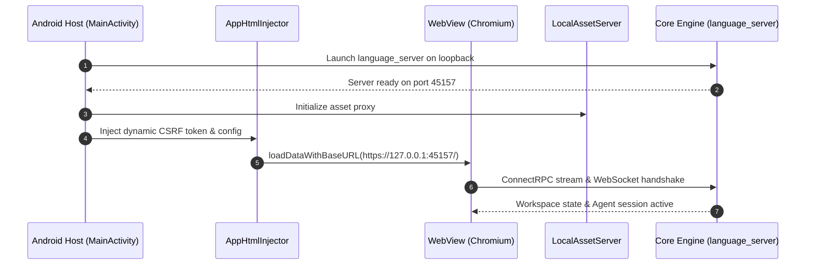

# Web Frontend Subsystem (`web/`)

> Single Page Application (React SPA) executed inside the sandboxed Android WebView, communicating with the local core engine (`language_server`) via loopback HTTPS and the native Java bridge (`AndroidBridge`).

---

## 1. Architectural Overview

The web layer provides an optimized touch-first developer interface packaged within the app's internal assets. Rather than loading over `file:///android_asset/` (which restricts browser APIs and ConnectRPC streaming), the interface mounts inside WebView via `loadDataWithBaseURL` targeting the trusted loopback server origin (`https://127.0.0.1:<port>/`).



---

## 2. Directory Layout & Key Components

```
web/
├── index.html              # Single page application entrypoint
├── css/
│   ├── main.css            # Core layout, reset, and dark/light variables
│   ├── editor.css          # Monospace editor styles & gutter formatting
│   └── terminal.css        # PTY terminal emulator styling (xterm.js)
├── js/
│   ├── app.js              # Application root and state machine initialization
│   ├── bridge.js           # Bidirectional communicator with window.Android
│   ├── rpc_client.js       # ConnectRPC / gRPC-Web streaming client
│   └── terminal_bridge.js  # WebSocket bridge linking PTY shell to terminal UI
└── assets/                 # SVGs, icons, and embedded web fonts
```

---

## 3. Key Features

1. **Adaptive Viewport Modes:**
   - **Mobile Touch Layout:** Optimized for single-hand touch interactions with gesture drawers, bottom navigation bars, and quick terminal toggles.
   - **Desktop / DeX Mode:** Full multi-pane IDE layout with dockable file tree, split editor tabs, and terminal drawer tailored for Samsung DeX and Android tablets.
2. **Real-time Agent Telemetry:** Live streaming logs showing agent thought processes, file diff inspections, and terminal command execution in real time.
3. **Hardened Local Communication:** Disallows external script loads; communicates strictly with loopback endpoints via dynamic authentication tokens.
